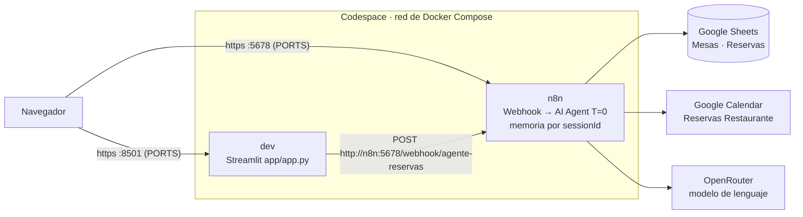

# Proyecto Final — Agente de reservas para restaurante (Grupo04_Reservas)

Procesamiento de Lenguaje Natural · Universidad Nacional de Colombia, sede Manizales.

Un agente en **n8n** atiende reservas en lenguaje natural: consulta la disponibilidad real de mesas en
**Google Sheets**, y solo con confirmación explícita registra la reserva en Sheets y crea su evento en
**Google Calendar**. La interfaz es un cliente delgado en **Streamlit** construido con Spec-Driven Development.

## Arquitectura



Regla de oro: el **navegador** usa las URL `https` de la pestaña PORTS; el **código** dentro del Codespace usa
`http://n8n:5678`. Decisiones y riesgos en [`PLAN.md`](PLAN.md).

## Puesta en marcha

1. **Crear el Codespace:** *Code → Codespaces → Create codespace on main*. Al terminar se instalan las
   dependencias de `app/requirements.txt` y quedan arriba los contenedores `dev` y `n8n`.
2. **Abrir n8n** desde la pestaña *PORTS* (puerto 5678, URL `https`) y crear el usuario local.
3. **Credenciales en n8n** (cada n8n crea las suyas; nunca van al repo):
   OpenRouter, Google Sheets OAuth2 API y Google Calendar OAuth2 API.
   Pasos y errores típicos: [`skills/google-calendar-n8n/SKILL.md`](skills/google-calendar-n8n/SKILL.md).
4. **Importar** `n8n/workflow.json`, reasignar credenciales en cada nodo y *Publish* ([`n8n/README.md`](n8n/README.md)).
5. **Verificar:**
   ```bash
   bash scripts/verificar_entorno.sh
   python scripts/probar_contrato.py --memoria
   ```
6. **Interfaz:** `streamlit run app/app.py` y abrir el puerto 8501 desde *PORTS*.

Variables: ver [`app/.env.example`](app/.env.example). El ID del calendario se define como secreto de Codespaces
`RESERVAS_CALENDAR_ID` (*Settings → Secrets and variables → Codespaces*) y luego
`cd .devcontainer && docker compose up -d --force-recreate n8n`.

## Estructura

| Ruta | Contenido |
| --- | --- |
| `SPEC.md`, `PLAN.md`, `TASKS.md`, `AGENTS.md` | documentación SDD |
| `app/` | cliente Streamlit (`app.py`, `requirements.txt`, `.env.example`) |
| `n8n/workflow.json` | workflow del agente exportado de n8n |
| `n8n/pruebas/` | workflows de prueba de infraestructura (no son parte del agente) |
| `skills/` | fichas reutilizables con el conocimiento propio del proyecto |
| `scripts/` | verificación del entorno, del contrato y de secretos |
| `evidencias/` | evidencia de cierre de cada tarea de `TASKS.md` |
| `.devcontainer/` | definición del Codespace (Docker Compose: `dev` + `n8n`) |
| `Presentacion.pdf` | presentación final y su archivo fuente |

## Equipo

| Integrante | Rol | Entregables |
| --- | --- | --- |
| Integrante 1 | Infraestructura e integración | Codespace, repositorio, Google Cloud/Calendar, integración final |
| Integrante 2 | Workflow y agente en n8n | Google Sheets, `workflow.json`, agente, herramientas y memoria |
| Integrante 3 | Interfaz, SDD y documentación | `app.py`, comprobante PDF, SPEC/PLAN/TASKS, matriz de pruebas, presentación |

## Enlaces

- Demostración: *(por completar)*
- Presentación: [`Presentacion.pdf`](Presentacion.pdf) *(por completar)*
